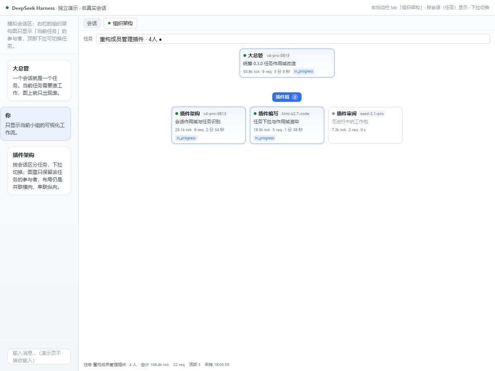
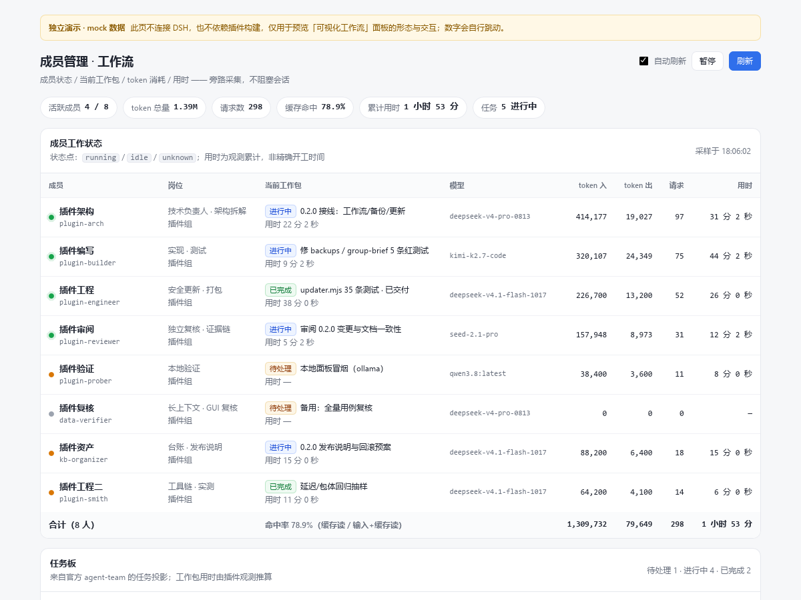
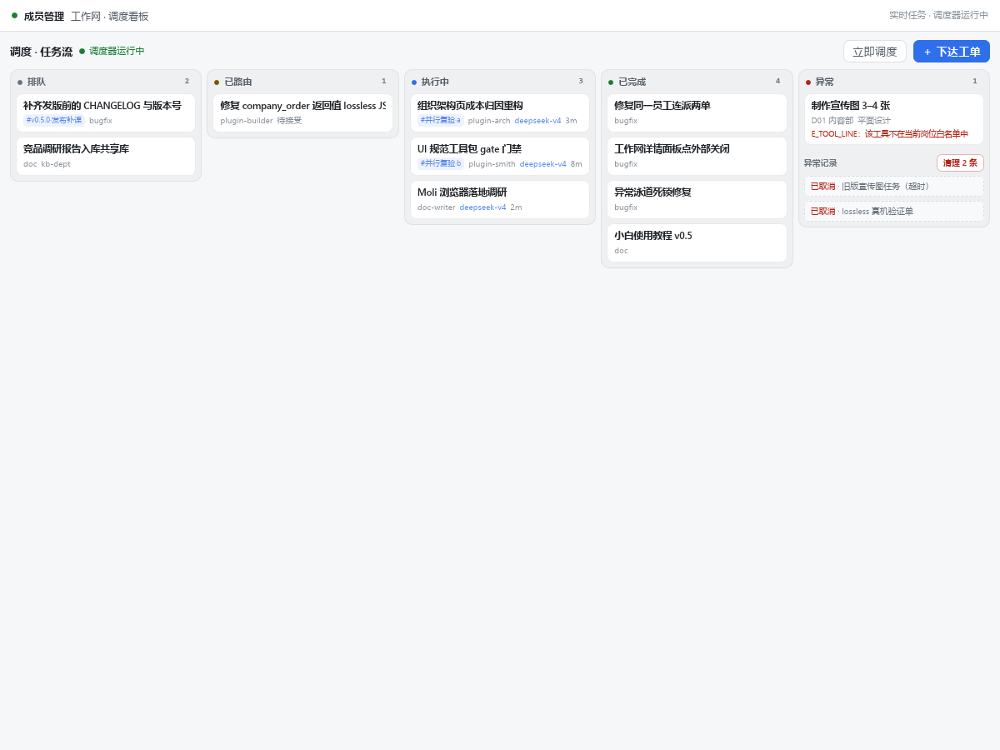

<div align="center">

# 📇 DSH Member Manager / 成员管理

**A DeepSeek Harness plugin for a runnable company org — departments, employee codes, dual M/P channels, DAG dispatch, audit and cost attribution.**

**给 DeepSeek Harness（DSH）加一层可运行的公司化组织**：部门与工号、M/P 双通道等级、工单派工与验收、任务图（DAG）并行派发、审计与成本归因；名册覆盖层负责显示名 / 岗位 / 职责 / 技能 / 模型覆盖。

`dsh-member-manager` · **v0.5.0** · MIT · Node ≥ 22.19 · 零运行时依赖

> 新手先看 [docs/28-新手使用教程.md](./docs/28-新手使用教程.md)。

点击下方标题可查看 **中文** 或 **English**。  
Click a heading below to view **English** or **中文** .

</div>

---

<details open>

<summary><b>🀄 中文（默认打开）</b></summary>

## 简介

本插件在 DSH 的「成员名不可改、不可删」约束之上，维护一层**名册覆盖层**（显示名 / 岗位 / 职责 / 技能 / 模型覆盖），并在其上提供**公司化运行时**：部门编号、员工工号、M/P 双通道等级、工单与派工凭证、任务图（DAG）并行派发、审计与 token 成本归因。

- 数据目录 `~/.dsh/storages/member-manager/`（名册与公司化数据格式稳定，可跨版本升级）
- 入口：设置 →「成员管理」面板；对话里的 `member_*`（16 个）与 `company_*`（14 个）工具

## 界面一览



*组织架构：管理层 → 部门/小组 → 成员拓扑，按会话（任务）切换（独立演示渲染）*



*工作流面板：成员工作状态、任务板与统计（独立演示渲染）*



*工作网调度看板：排队 / 已路由 / 执行中 / 已完成 / 异常 五条泳道，异常泳道含异常记录与清理（独立演示渲染）*

> 截图来自 `demo/` 的独立演示页（`demo/*.html`，不连 DSH，数据为 mock）；真实面板请在 DSH 设置 →「成员管理」打开。

## 快速开始

1. 安装（见「安装」；当前用本地 link 或 tgz）。
2. **重启 DSH**（插件不支持热重载）。
3. 设置 →「成员管理」→「总架构」。
4. 「新建部门」→ 输入一句话（如「新建市场部，编制 5 人」）→「创建预览」→「创建」。
5. 对话里派活：`company_order`（或 `company_plan` 提交任务图）→ `company_assign` → 员工 `company_accept` / `company_report` → `company_review`。

## 核心能力

| 能力 | 说明 |
| --- | --- |
| 组织 | 部门编号 `D01…`（模板可自定义）、编制、接单范围、借调策略、职责描述；仅空部门可删除 |
| 员工 | 工号 `E0001…`、M/P 双通道等级（可并存）、岗位/职责/技能/模型覆盖、停用/调岗；v0.4 追加推理强度 / 派生方式 spawn·fork / 子代理深度 / 工具黑白名单 / 会话策略 |
| 总架构 | 管理层（虚拟聚合节点，M 通道）→ 部门图框 → 员工卡；管理层可重命名，编号规则与等级目录可「自定义」 |
| 员工中心 | 全量员工列表，按部门/等级排序，支持部门、停用与名册关联状态筛选；行内显示「名册·已登记 / 未登记 / 已停用」徽章，可单个或批量登记 |
| 名册关联 | 公司员工与 `registry.json` 双向关联：缺省「员工 id 即名册 target」（12 名历史员工零迁移），需要别名时写显式 `rosterTarget`；登记沿用「只补空字段、绝不覆盖」，`refresh` 才回填；`member_list` 附带公司关联、`member_diagnose` 报告 `rosterLinks`，CLI `scripts/roster-link.mjs` 可 --list / 按部门 / 单员工登记 |
| 人事管理 | 行内展开详情：公司化资料（3 列：显示名/岗位、技能/模型选择器、职责 ≤8 条）+ 通道 / 晋升 / 停用 / 调岗 |
| 部门弹层 | 两个页签（部门架构图 / 成员详情），内可招聘，页签行有「部门编辑」（名称/编号/编制/描述/接单范围/借调策略） |
| 工作网 | 右侧栏，**只在点「工作网」按钮时打开，绝不自动弹出**：上半部五泳道任务看板（待派/已路由/执行中/已完成/异常）+ KPI + 调度器状态 + 部门产能条，卡片点开详情、派工、验收、升级、取消，点详情外任意处收起；异常泳道只显示当前卡住的工单，历史异常归入「异常记录」区（可手动清理），无卡单时显示「重启进度」按钮；下半部管理层 → 部门 → 员工拓扑（工号/等级/任务/用量），空闲折叠，2s 刷新；公司化关闭时回退任务视图 |
| 派工闭环 | order → 五级路由回退（显式部门 / 规则表 / 部门接单范围 / 技能 / 兜底）→ attempt（派工凭证）→ accept → report → review；`attemptId` 防串单、重派先吊销旧 attempt、派工失败回滚重派、重启后冷恢复、终态订单孤儿 attempt 自动回收；忙碌门禁（`E_EMPLOYEE_BUSY`）防止同一员工被连派两单；调度器按优先级 + 依赖 + 部门产能派工，满编部门不再饿死其它部门 |
| 并行派发（DAG） | `company_plan` 一次提交任务图（≤50 任务），用 `key` 互相声明依赖；无依赖同层并行派发，下游等上游 `done` 自动放行；内置环检测等 6 类校验（`E_PLAN_EMPTY` / `TOO_LARGE` / `TASK_INVALID` / `DUP_KEY` / `BAD_REF` / `CYCLE`）；`company_status({group})` 按批次汇总 done/running/pending/failed |
| 成本 & 审计 | token/请求按员工 / 部门 / 工单归因（`GET /company/costs`）；`audit.jsonl` append-only、加载时重放对账 |
| 隔离与降级 | 员工会话继承宿主标准工具；公司管理工具（`company_*`）走同步 guard + 执行体会话反查（v5.24 起不再收窄工具面）；越权 `E_TOOL_LINE`，缺宿主服务 `E_NO_AGENTS`，开关关闭 `E_DISABLED`，均不影响名册功能 |

## M/P 双通道与编号

| 通道 | 默认等级目录 | 默认等级 |
| --- | --- | --- |
| M 管理 | M1 主管 / M2 经理 / M3 高级经理 / M4 总监 / M5 副总裁 | `manager` → M2 |
| P 技术 | P1 初级工程师 / P2 工程师 / P3 高级工程师 / P4 资深工程师 / P5 技术专家 / P6 首席专家 | `staff` → P3、`window` → P1 |

- 同一员工可同时拥有 M 与 P 等级：`channels:[{channel,level}]`，至少一个；`manager` 必含 M、`window` 仅 P。
- 晋升：同通道逐级 ±1；跨通道需显式目标等级且 `role` 跟随（`window` 不可转 M）。
- 编号模板：默认 `E{seq:4}` / `D{seq:2}`，占位符 `{seq}` `{seq:N}` `{dept}` `{channel}` `{level}`；优先级 `company.json` 持久值 > 配置 > 内置默认。
- 历史数据 boot 时自动补号补通道（非法等级回退默认），不丢员工。

## 安装

**方式 A：npm（`dsh-member-manager`）**

```bash
dsh plugin --profile desktop add dsh-member-manager@0.5.0
```

**方式 B：本地源码**

```bash
dsh plugin --profile desktop add link:"<本仓库绝对路径>"
```

**方式 C：从旧包升级**（`dsh-plugin-member-manager` → `dsh-member-manager`）

```bash
node scripts/migrate-old-plugin.mjs          # 1) dry-run，不动任何文件
node scripts/migrate-old-plugin.mjs --apply  # 2) 备份 profile → 改写三处登记 → 写迁移标记
# 3) 重启 DSH：首次启动消费标记，把名册迁移成公司化组织（只迁 active 成员、只补空档案、幂等）
```

> 旧包名有转发包（`compat/dsh-plugin-member-manager`，0.3.1）可继续安装并转发到本包；两个包**不要同时启用**（重复注册工具/路由，共用数据目录）。

### 卸载

删除 profile 三处登记（`dependencies`、`dsh.profile.bundles`、`cordis.yml`；或 `dsh plugin --profile desktop remove dsh-member-manager`）后重启 DSH。数据保留在 `~/.dsh/storages/member-manager/`，可手动删除。

## 与旧插件 `dsh-plugin-member-manager` 的关系

本包是旧插件的**重命名升级版**。两者同源：从同一份代码 fork 而来，数据目录、名册文件格式和 16 个名册工具名保持一致；区别是包名 / 插件 id 改为 `dsh-member-manager`，并新增公司化运行时（部门 / 工号 / 双通道 / 工单 / DAG 并行 / 审计 / 成本）与 14 个 `company_*` 工具。

| 维度 | 旧包 `dsh-plugin-member-manager` | 新包 `dsh-member-manager` |
| --- | --- | --- |
| 数据目录 | `~/.dsh/storages/member-manager/` | 相同（升级不迁移、不丢数据） |
| 名册文件 | `registry.json`（成员 / 小组 / 技能 / 模型覆盖 / 备份） | 相同格式，直接读写 |
| 名册工具 | 16 个 `member_*` / `group_manage` / `skill_list` / `model_list` | **同名保留**，旧脚本可继续用 |
| 公司化数据 | 无 | 新增 `company/`（部门 / 员工 / 工单 / 审计 / 成本） |
| 面板 | 组织架构 · 已停用 · 未登记 · 工作流 · 维护 | 总架构 · 员工中心 · 工作流 · 备份与更新 |
| 维护状态 | 停止更新 | 唯一维护版本 |

> 名册里的「小组」在新版只作**覆盖层与迁移来源**（面板以部门组织为主）；`company/` 数据旧包不存在，升级后为空，由「一键迁移」或面板自行建立。

### 不能同时启用

新旧包共用一个 DSH profile 时会重复注册 25 个名册工具与 16 条 HTTP 路由，并写入同一个数据目录，属未定义行为。切换前必须先移除旧包。

### 三种切换方式

| 方式 | 命令 | 适用场景 |
| --- | --- | --- |
| 一键迁移（推荐） | `node scripts/migrate-old-plugin.mjs` → `--apply` → 重启 | 已装旧包，并希望把名册迁成公司化组织 |
| 只切插件 | `node scripts/switch-to-dsh-member-manager.mjs` → `--apply` → 重启 | 已装旧包，只换包，公司化组织稍后自建 |
| 手工 | 删除 profile 三处旧登记（`dependencies` / `dsh.profile.bundles` / `cordis.yml`）与旧 `node_modules` 链接，再按「安装」加新包，重启 | 喜欢自己动手 |

两个脚本都默认 **dry-run**，`--apply` 时先把 `package.json` / `cordis.yml` 备份到 `~/.dsh/backups/`；回滚用 `node scripts/rollback-to-dsh-plugin-member-manager.mjs --apply`。

### 旧包名转发包

`compat/dsh-plugin-member-manager`（v0.3.1）保留旧包名可安装：它只依赖新包，并把 host / client 入口 `export *` 转发，`cordis.patch.yml` 仍插入旧 id。用于「CI / 脚本里写死旧包名」的过渡期；**同样不能与新包同装**，过渡完请移除。

### npm 上的处理

npm 没有包名重定向。发布新包后建议对旧包执行 `npm deprecate dsh-plugin-member-manager@* "已更名为 dsh-member-manager，请安装新包"`；旧用户先 `dsh plugin --profile desktop remove dsh-plugin-member-manager`（或跑上面的切换脚本），再安装新包。

## 使用

> **第一次用？** 先读 [docs/28-新手使用教程.md](./docs/28-新手使用教程.md)——从建部门到验收，五分钟跑通第一单，不需要懂代码。

- **对话**：`member_list` / `member_add` 管理名册；`company_hire` / `company_admin` 建公司组织；`company_order` 起单，`company_plan` 起任务图。
- **面板**：总架构（新建部门、编号/等级自定义、部门编辑、开发模式预设徽章与部门弹层「开发模式」页签）· 员工中心 · 工作流 · 备份与更新。套用「游戏开发模式」后，部门卡显示模式徽章，弹层第三页签展示 7 个岗位槽位（自动匹配在职员工）与 7 阶段流水线（目标 / 负责人 / 参与 / 交付物 / 验收门禁），可切换或清除。
- **同步核心成员**：面板「同步核心成员」按钮，或调用 `member_sync`（HTTP 路由拿不到 Agent 凭证，需工具触发一次）。
- **HTTP**：`GET /api/dsh-member-manager/{health,state,skills,overrides,models,orgmap,workflow,update,backups}`、`POST …/op`；公司化只读 `GET …/company/{overview,org,board,costs,orders,presets}`、写 `POST …/company/op`。

## 配置项

| 字段 | 默认 | 说明 |
| --- | --- | --- |
| `dataDir` / `registryFile` | `~/.dsh/storages/member-manager` / `{dataDir}/registry.json` | 数据目录与名册文件 |
| `scanLocalSkills` / `extraSkillRoots` | `true` / `[]` | 是否扫盘补技能目录、追加扫描根 |
| `backups` | `{enabled:true,keep:20,dailyKeep:7}` | 名册自动备份保留策略 |
| `workflow` | `{enabled:true,persistMs:5000,retentionHours:6,tasksPollMs:3000}` | 工作流采集 |
| `update` | `{enabled:true,checkOnBoot:false,autoStage:false,allowOnlineApply:false}` | 分阶段自更新（不在运行中替换自身） |
| `enabled` / `company.enabled` | `true` | 公司化总开关 |
| `company.autoBoot` / `company.provider` | `true` / `"spawn"` | 非阻塞自动 boot；派工 subagent provider（写错 → `NO_PROVIDER`） |
| `company.autoLinkRoster` | `true` | 新建部门 / 新增员工后自动登记名册（名册可用时 best-effort；失败不阻塞创建） |
| `company.defaultSessionPolicy` / `managerActsAsStaff` | `"per_task"` / `false` | 会话策略；经理是否可被派活 |
| `company.defaultOrderMode` / `requireManagerReview` | `"async"` / `true` | 下单模式；是否需要经理验收 |
| `company.limits` | 见下 | `{maxConcurrentPerProvider:4,maxTemps:4,budgetTokensPerDay:5000000,attemptTimeoutMs:1800000,lostReportGraceMs:120000,staleAttemptMs:3600000,schedulerIntervalMs:5000}`；当前仅校验与展示，并发/预算闸门尚未强制 |
| `company.departments` / `routingRules` / `toolPolicies` | `[]` / `[]` / `{}` | 种子部门 / 下单路由 / 分线工具策略 |
| `company.levels` / `numbering` | 内置 M1–M5、P1–P6 / `E{seq:4}`、`D{seq:2}` | 等级目录 / 编号模板（非法回退默认 + warning） |

## 工具

**名册工具（16 个，覆盖层，兼容保留）**

`member_list` `member_add` `member_rename` `member_remove` `member_set_role` `member_set_skills` `member_set_model` `group_manage` `member_sync` `member_diagnose` `member_backup` `member_group_from_text` `member_workflow` `member_update` `skill_list` `model_list`

**公司化工具（14 个）**

| 工具 | 线 | 作用 |
| --- | --- | --- |
| `company_order` | 窗口 | 下单：`{type,title,dept?,priority?,deps?,acceptance?,clientOrderId?,mode?}` |
| `company_plan` | 窗口 | 一次提交任务图（DAG）：`{group?,tasks:[{key?,type,title,deps?,priority?,dept?,detail?,project?,acceptance?}]}`。同层无依赖的任务并行派发，下游等上游 `done` 自动放行；返回 `{group,count,parallel,layers,orders}` |
| `company_status` | 窗口 | 查询工单/员工/部门视图：`{orderId?,group?}`；带 `group` 时附该批次的 done/running/pending/failed 汇总 |
| `company_ask` | 窗口 | 催办：`{orderId,question}` |
| `company_cancel` | 窗口 | 取消工单：`{orderId}` |
| `company_assign` | 经理 | 派工：`{orderId,employeeId}` → `{attemptId,sessionId}` |
| `company_review` | 经理 | 验收：`{orderId,pass}`（通过 / 打回） |
| `company_borrow` | 经理 | 借调共享员工：`{orderId,sharedEmployeeId}` |
| `company_escalate` | 经理 | 升级转 owner：`{orderId,reason?}` |
| `company_report` | 经理/员工 | 回报（必带 `attemptId`）：`{orderId?,attemptId,status,summary,artifacts?,acceptanceResults?}` |
| `company_accept` | 员工 | 接受派工：`{attemptId}` |
| `company_ask_help` | 员工 | 求助并转发经理：`{attemptId,question?}` |
| `company_hire` | OWNER | 新增员工：`{id,displayName?,department?,role?,kind?,code?,channel?,level?,channels?,title?,duties?,model?,provider?}`（成功即自动登记名册，见 `company.autoLinkRoster`） |
| `company_admin` | OWNER | 控制面：`{action,args}`，17 个 action——`createDepartment` `createEmployee` `updateDepartment` `promoteEmployee` `setChannels` `setNumbering` `setManagementName` `setCompanyName` `setLevels` `updateEmployeeProfile` `importRosterProfiles` `linkEmployeeRoster` `syncEmployeesRoster` `unlinkEmployeeRoster` `setRoutingRules` `applyDepartmentPreset` `clearDepartmentPreset` |

> 线隔离：OWNER 14 / 经理 12 / 员工 5 / 窗口 5（白名单见 `src/host/company-compat.mjs`）。越权 → `E_TOOL_LINE`；宿主缺 `agents`/`subagents` → `E_NO_AGENTS`。

## 开发与测试

```bash
npm run check   # 语法校验（lib/ src/ scripts/ compat/）
npm test        # 655 tests / 655 pass
npm run verify  # 22 项交付自检（元数据/文件/语法/导出契约/面板字样/游戏开发模式预设/公司与名册关联/自动登记/测试不污染用户目录）
```

- 结构：`lib/` 插件入口与客户端 bundle · `src/shared/` 纯函数内核 · `src/host/` 运行时 · `test/` 测试 · `docs/` 契约与独立审阅 · `demo/` 独立演示页与截图 · `scripts/` 切换 / 回滚 / 迁移 / 验证。
- 零运行时依赖，仅使用 Node 内置模块与宿主注入服务。

## 数据与限制

- 数据：`registry.json`（名册）· `company/company.json` + `company/audit.jsonl` + `company/ledger/`（公司化）· `backups/`（自动备份）· `boot.log` · `workflow-stats.json` · `pending-migration.json`（迁移标记）；脚本备份写 `~/.dsh/backups/`。
- 已知限制：并发/预算闸门当前仅校验未强制；成本为进程内计数（重启清零）；工程验证以 Windows 11 + Node 24 为主；历史文档中的旧包名保留。

## 许可证

MIT（见 [LICENSE](./LICENSE)）；第三方许可见 [THIRD-PARTY-NOTICES.md](./THIRD-PARTY-NOTICES.md)；历史版本见 [CHANGELOG.md](./CHANGELOG.md)。

</details>

---

<details>

<summary><b>🌐 English</b></summary>

## Overview

**A runnable "company" layer for DeepSeek Harness (DSH)**: departments and employee codes, dual M/P career channels, order dispatch with accept/report/review, task-graph (DAG) parallel dispatch, an audit trail and cost attribution. A roster overlay keeps display names, titles, duties, skills and per-member model overrides.

- Version **0.5.0** · MIT · Node ≥ 22.19 · zero runtime dependencies
- Data: `~/.dsh/storages/member-manager/`
- Entry points: Settings → "Member Manager" panel; `member_*` (16) and `company_*` (14) host tools

## Screenshots


*Organization chart: management → departments/groups → members, switchable by session/task (standalone demo render).*


*Workflow panel: member work status, task board and stats (standalone demo render).*


*Work board (scheduling kanban): queued / routed / running / done / abnormal lanes; the abnormal lane carries exception history + one-click clear (standalone demo render).*

> Screenshots come from standalone demo pages under `demo/` (`demo/*.html`, not connected to DSH, mock data); open the real panels via DSH Settings → "Member Manager".

## Quick start

1. Install (see *Installation*), then **restart DSH** (no hot reload).
2. Settings → "Member Manager" → *Overall architecture*.
3. "New department" → one sentence (e.g. "create Marketing with 5 headcount") → "Create preview" → "Create".
4. Dispatch from chat: `company_order` (or `company_plan` for a task graph) → `company_assign` → employee `company_accept` / `company_report` → `company_review`.

## Features

| Area | What you get |
| --- | --- |
| Organization | Department codes `D01…` (customizable templates), capacity, accepts, borrow policy, charter; only empty departments can be deleted |
| Employees | Employee codes `E0001…`, dual M/P channels (both at once), title/duties/skills/model override, disable/transfer; v0.4 adds reasoning effort / member provider spawn·fork / max depth / tool allow-deny / session policy |
| Overall architecture | Virtual Management node (M channel) → department boxes → employee cards; rename Management, customize numbering and level directories |
| Employee center | Full employee list sorted by department/level with department and disabled filters |
| Roster link | Bidirectional link between company employees and `registry.json`: default "employee id is the roster target" (12 legacy employees migrate with zero work), explicit `rosterTarget` only when aliasing is needed; registration only fills blank fields (never overwrites), `refresh` backfills; `member_list` carries the company link, `member_diagnose` reports `rosterLinks` |
| Personnel | Inline detail: company profile in 3 columns (display name/title, skill/model pickers, duties ≤8) plus channels / promote / disable / transfer |
| Work network | Right sidebar, **opens only when you click the 工作网 button — never auto-opens**: top half is a five-lane task board (queued / routed / running / done / abnormal) with KPIs, scheduler state and capacity bars; cards open an order drawer with assign / review / escalate / cancel, and close when you click anywhere outside the detail; the abnormal lane shows only currently-stuck orders — historical exceptions live in an "Exception history" area (with a manual clear button), and when nothing is stuck a "Restart progress" button is shown; bottom half is the Management → department → employee topology (code/level/task/usage), idle folded, 2s refresh; falls back to the task view when the company runtime is off |
| Dispatch loop | order → five-step routing fallback (explicit dept / routing rules / department accepts / skills / capacity fallback) → attempt → accept → report → review; `attemptId` blocks stale reports, reassignment revokes the old attempt, failed dispatch rolls back and retries, restarts cold-recover orphan attempts (including orphans under terminal orders); a busy guard (`E_EMPLOYEE_BUSY`) stops one employee being assigned two orders at once; the scheduler honours priority + dependencies + department capacity, and a saturated department no longer starves the rest of the queue |
| Parallel dispatch (DAG) | `company_plan` submits a task graph (≤50 tasks) with `key`-based dependencies; same-layer tasks run in parallel, downstream releases automatically when its upstream reaches `done`; built-in cycle detection plus 5 other validations (`E_PLAN_EMPTY` / `TOO_LARGE` / `TASK_INVALID` / `DUP_KEY` / `BAD_REF` / `CYCLE`); `company_status({group})` aggregates done/running/pending/failed per batch |
| Cost & audit | Tokens/requests attributed per employee / department / order (`GET /company/costs`); append-only `audit.jsonl` replayed on load |
| Isolation | Employee sessions inherit host tools; `company_*` management tools use a synchronous guard + session lookup (no tool-surface narrowing since v5.24); `E_TOOL_LINE`, `E_NO_AGENTS`, `E_DISABLED` never break roster features |

## M/P channels & numbering

| Channel | Default levels | Default level |
| --- | --- | --- |
| M (management) | M1 Supervisor / M2 Manager / M3 Senior Manager / M4 Director / M5 VP | `manager` → M2 |
| P (professional) | P1 Junior Engineer / P2 Engineer / P3 Senior Engineer / P4 Staff Engineer / P5 Expert / P6 Principal Expert | `staff` → P3, `window` → P1 |

- `channels:[{channel,level}]` — at least one; `manager` must include M, `window` is P-only.
- Promotion: ±1 level within a channel; switching channels requires an explicit target level and the matching role.
- Numbering: `E{seq:4}` / `D{seq:2}` with `{seq}` `{seq:N}` `{dept}` `{channel}` `{level}`; persisted `company.json` > config > built-in defaults.
- Loading legacy data backfills codes and channels without dropping employees.

## Installation

**Option A — npm (`dsh-member-manager`)**

```bash
dsh plugin --profile desktop add dsh-member-manager@0.5.0
```

**Option B — local source**

```bash
dsh plugin --profile desktop add link:"<repo path>"
```

**Option C — upgrade from the old package**

```bash
node scripts/migrate-old-plugin.mjs          # 1) dry-run, writes nothing
node scripts/migrate-old-plugin.mjs --apply  # 2) back up profile, rewrite 3 registrations, write the migration marker
# 3) restart DSH: the marker is consumed on first boot and the roster is migrated into the company org (idempotent)
```

> A shim package under the old name (`compat/dsh-plugin-member-manager`, 0.3.1) re-exports this package. Never enable both at once.

**Uninstall**: remove the three profile registrations (or `dsh plugin --profile desktop remove dsh-member-manager`) and restart. Data stays under `~/.dsh/storages/member-manager/`.

## Relationship to the old `dsh-plugin-member-manager`

This package is the **renamed successor** of the old plugin. It is forked from the same code base: the data directory, `registry.json` format and the 16 roster tool names are unchanged. What differs is the package name / plugin id (`dsh-member-manager`), the new company runtime (departments, employee codes, dual M/P channels, orders, DAG dispatch, audit, cost) and 14 `company_*` tools.

| Aspect | Old package | New package |
| --- | --- | --- |
| Data directory | `~/.dsh/storages/member-manager/` | same — upgrade in place, nothing migrated away |
| Roster file | `registry.json` (members / groups / skills / model overrides / backups) | same format, read and written directly |
| Roster tools | 16 `member_*` / `group_manage` / `skill_list` / `model_list` | kept under the same names |
| Company data | none | new `company/` (departments / employees / orders / audit / cost) |
| Panel | Organization · Retired · Unregistered · Workflow · Maintenance | Overall architecture · Employee center · Workflow · Backups & updates |
| Maintenance | no longer updated | the only maintained version |

> "Groups" in the roster now serve as a **compatibility overlay and migration source** only; the panel is department-centric. `company/` is new and starts empty — populate it with the one-step migration or from the panel.

### Never enable both

Both packages in one DSH profile would register 25 roster tools and 16 HTTP routes twice and write the same data directory — undefined behaviour. Remove the old package first.

### Three ways to switch

| Way | Command | When |
| --- | --- | --- |
| One-step migration (recommended) | `node scripts/migrate-old-plugin.mjs` → `--apply` → restart | old package installed and you want the roster migrated into the company org |
| Swap the package only | `node scripts/switch-to-dsh-member-manager.mjs` → `--apply` → restart | old package installed, only switching the package |
| Manual | drop the three old profile registrations (`dependencies`, `dsh.profile.bundles`, `cordis.yml`) and the old `node_modules` link, then install as in *Installation*, restart | you prefer doing it by hand |

Both scripts default to **dry-run** and back up `package.json` / `cordis.yml` into `~/.dsh/backups/` before `--apply`. Roll back with `node scripts/rollback-to-dsh-plugin-member-manager.mjs --apply`.

### Shim package under the old name

`compat/dsh-plugin-member-manager` (v0.3.1) keeps the old name installable: it depends on the new package and re-exports host / client entry points, while its `cordis.patch.yml` still inserts the old id. Intended for a transition period when CI or scripts hard-code the old name; **it must not be enabled together with the new package**.

### On npm

npm has no package-name redirection. After publishing, deprecate the old one: `npm deprecate dsh-plugin-member-manager@* "renamed to dsh-member-manager, please install the new package"`. Old users should `dsh plugin --profile desktop remove dsh-plugin-member-manager` (or run the switch script) before installing the new package.

## Usage

- **Chat**: `member_list` / `member_add` for the roster; `company_hire` / `company_admin` for the org; `company_order` to dispatch, `company_plan` to dispatch a task graph.
- **Panel**: Overall architecture · Employee center · Workflow · Backups & updates; the "Sync core members" button or `member_sync` imports core team members into the roster; the employee center shows roster-link badges (linked / unlinked / retired), filters by link status and registers one employee or a whole department into the roster (only blank fields are filled; `refresh` overwrites). A department can apply the built-in "Game dev mode" preset: its card shows a mode badge and the department modal's third tab lists the 7 role slots (auto-matched to current employees) plus the 7-stage pipeline (goal / owner / participants / deliverables / acceptance gates), with switch and clear actions.
- **HTTP**: `GET /api/dsh-member-manager/{health,state,skills,models,orgmap,workflow,backups}`, `POST …/op`; company read-only `GET …/company/{overview,org,board,costs,orders,presets}`, write `POST …/company/op`.

## Configuration (highlights)

`dataDir` · `registryFile` · `scanLocalSkills` · `extraSkillRoots` · `backups` · `workflow` · `update` · `enabled` · `company.autoBoot` · `company.autoLinkRoster` · `company.provider` (`"spawn"`) · `company.defaultSessionPolicy` / `managerActsAsStaff` · `company.defaultOrderMode` / `requireManagerReview` · `company.limits` (validated and shown only; concurrency/budget gates are not enforced yet; includes `schedulerIntervalMs: 5000`) · `company.departments` / `routingRules` / `toolPolicies` · `company.levels` / `numbering`.

## Tools

Roster (16): `member_list` `member_add` `member_rename` `member_remove` `member_set_role` `member_set_skills` `member_set_model` `group_manage` `member_sync` `member_diagnose` `member_backup` `member_group_from_text` `member_workflow` `member_update` `skill_list` `model_list`.

Company (14): `company_order` `company_plan` `company_status` `company_ask` `company_cancel` `company_assign` `company_review` `company_borrow` `company_escalate` `company_report` `company_accept` `company_ask_help` `company_hire` `company_admin` (17 actions: `createDepartment` `createEmployee` `updateDepartment` `promoteEmployee` `setChannels` `setNumbering` `setManagementName` `setCompanyName` `setLevels` `updateEmployeeProfile` `importRosterProfiles` `linkEmployeeRoster` `syncEmployeesRoster` `unlinkEmployeeRoster` `setRoutingRules` `applyDepartmentPreset` `clearDepartmentPreset`).

Tool lines: OWNER 14 / manager 12 / staff 5 / window 5.

## Development & tests

```bash
npm run check   # syntax check
npm test        # 655 tests / 655 pass
npm run verify  # 22 delivery self-checks
```

## Data & limits

`registry.json`, `company/{company.json,audit.jsonl,ledger/}`, `backups/`, `boot.log`, `workflow-stats.json`, `pending-migration.json`; script backups live in `~/.dsh/backups/`. Known limits: concurrency/budget gates are validated only, cost counters are in-process (reset on restart), engineering verification is Windows 11 + Node 24 first.

## License

MIT — see [LICENSE](./LICENSE) and [THIRD-PARTY-NOTICES.md](./THIRD-PARTY-NOTICES.md); release history in [CHANGELOG.md](./CHANGELOG.md).

</details>
